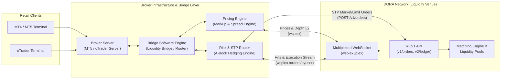
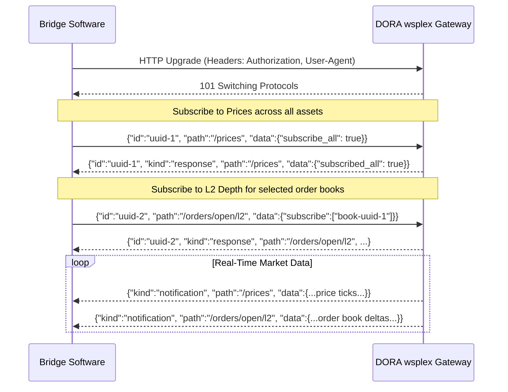
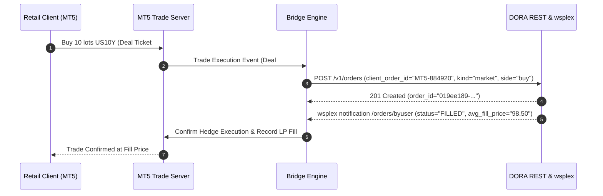

# Bridge Provider Integration Guide

- [Bridge Provider Integration Guide](#bridge-provider-integration-guide)
  - [1. Introduction \& Architecture Overview](#1-introduction--architecture-overview)
    - [Purpose](#purpose)
    - [Target Audience](#target-audience)
    - [High-Level Integration Topology](#high-level-integration-topology)
  - [2. Key Differences from Retail / Standard Integrations](#2-key-differences-from-retail--standard-integrations)
    - [Architecture Comparison](#architecture-comparison)
    - [Omnibus Account vs. End-User Account Topology](#omnibus-account-vs-end-user-account-topology)
    - [Matching Engine Nuances: Liquidity Pools vs. Order Books](#matching-engine-nuances-liquidity-pools-vs-order-books)
  - [3. Environment \& Authentication](#3-environment--authentication)
    - [Base URLs](#base-urls)
    - [API Key Management](#api-key-management)
      - [Creating and Managing Keys via API](#creating-and-managing-keys-via-api)
    - [WebSocket Connection Headers](#websocket-connection-headers)
    - [Key Rotation Strategy](#key-rotation-strategy)
  - [4. Asset \& Symbol Mapping](#4-asset--symbol-mapping)
    - [DORA Asset Model: Fractionalized Bonds](#dora-asset-model-fractionalized-bonds)
    - [Querying Available Assets \& Order Books](#querying-available-assets--order-books)
    - [Translating to MT5 / cTrader Symbol Specifications](#translating-to-mt5--ctrader-symbol-specifications)
    - [Handling Bond Coupons](#handling-bond-coupons)
  - [5. Market Data Ingestion \& Pricing Engine](#5-market-data-ingestion--pricing-engine)
    - [Multiplexed WebSocket (`wsplex`) Architecture](#multiplexed-websocket-wsplex-architecture)
    - [Subscribing to Real-Time Prices (`/prices`)](#subscribing-to-real-time-prices-prices)
    - [Subscribing to Liquidity Pool Balances (`/pools/balance`)](#subscribing-to-liquidity-pool-balances-poolsbalance)
    - [Subscribing to Depth \& Order Book Stats (`/orders/open/l2`, `/orderbook/stats`)](#subscribing-to-depth--order-book-stats-ordersopenl2-orderbookstats)
    - [Constructing Broker Quotes \& Marking Up Spreads](#constructing-broker-quotes--marking-up-spreads)
    - [Snapshot \& Fallback REST Endpoints](#snapshot--fallback-rest-endpoints)
  - [6. STP Order Execution \& Hedging](#6-stp-order-execution--hedging)
    - [Straight-Through Processing (STP) Workflow](#straight-through-processing-stp-workflow)
    - [Order Submission (`POST /v1/orders`)](#order-submission-post-v1orders)
      - [Standard Market Hedge Order (1x / Unleveraged)](#standard-market-hedge-order-1x--unleveraged)
      - [Leveraged Hedge Order (from Isolated Position Account)](#leveraged-hedge-order-from-isolated-position-account)
    - [Correlating Broker Tickets with `client_order_id`](#correlating-broker-tickets-with-client_order_id)
    - [Order Execution on Omnibus Accounts: Market Orders Only](#order-execution-on-omnibus-accounts-market-orders-only)
    - [Order Modifiers \& Slippage Control](#order-modifiers--slippage-control)
    - [Cancelling Orders](#cancelling-orders)
  - [7. Position Management, Margin \& Leverage](#7-position-management-margin--leverage)
    - [Account Roles: Global Cash vs. Isolated Margin Accounts](#account-roles-global-cash-vs-isolated-margin-accounts)
    - [Automatic Collateral Transfers \& Cash Movement](#automatic-collateral-transfers--cash-movement)
    - [Automated Collateral Rebalancing Daemon](#automated-collateral-rebalancing-daemon)
    - [Worked Scenario: Automatic Cash and Collateral Movement](#worked-scenario-automatic-cash-and-collateral-movement)
    - [Leverage Calculation (`inverse_leverage`)](#leverage-calculation-inverse_leverage)
    - [The Global Account Cash Reserve Requirement](#the-global-account-cash-reserve-requirement)
    - [Short Selling \& Virtual Borrowing](#short-selling--virtual-borrowing)
    - [Position Offsetting \& Closing (`POST /v2/accounts/close`)](#position-offsetting--closing-post-v2accountsclose)
    - [Clearing Residual USD Debt (`POST /v1/positions/repay_usd`)](#clearing-residual-usd-debt-post-v1positionsrepay_usd)
  - [8. Real-Time Streaming \& Trade Reconciliation](#8-real-time-streaming--trade-reconciliation)
    - [Order Updates via `wsplex` (`/orders/byuser`)](#order-updates-via-wsplex-ordersbyuser)
    - [Balance \& Margin Streaming (`/accounts/balance`, `/pnl/byuser`)](#balance--margin-streaming-accountsbalance-pnlbyuser)
    - [Ledger Portfolio Snapshot (`GET /v2/ledger/accounts/self`)](#ledger-portfolio-snapshot-get-v2ledgeraccountsself)
    - [Trade \& Transaction Audit Trails (`GET /v1/trades`, `GET /v1/transactions`)](#trade--transaction-audit-trails-get-v1trades-get-v1transactions)
  - [9. Resilience, Error Handling \& Operational Best Practices](#9-resilience-error-handling--operational-best-practices)
    - [Common Order Rejection Codes](#common-order-rejection-codes)
    - [Connection Lifecycle \& State Resynchronization](#connection-lifecycle--state-resynchronization)
    - [Emergency Kill Switches \& Flushes](#emergency-kill-switches--flushes)

---

## 1. Introduction & Architecture Overview

### Purpose

The **DORA platform** (U.S. Patent 12,596,578) provides a digital institutional marketplace for fractionalized bonds. Every order book on DORA is backed by a separate underlying liquidity pool that determines the price of the bonds, and all orders cross against this liquidity pool. The order book provides additional liquidity through resting orders supplied by other users of the platform, including market makers, which are matched at the requested price level when the pool price reaches that limit price.

This guide details how **Bridge Providers**—software vendors supplying middleware and translation layers between retail trading platforms (such as MetaTrader 4, MetaTrader 5, and cTrader) and institutional liquidity venues—integrate with the DORA Network.

By integrating DORA into your bridge engine, you enable brokerages utilizing your bridge software to:

1. **Offer innovative CFD products** on fractionalized fixed-income securities and bonds to their retail and institutional client base.
2. **Aggregate real-time market data** from DORA with other market venues.
3. **Apply custom broker spreads and markups** to order books before distributing quotes to client trading terminals.
4. **Hedge client flow seamlessly via Straight-Through Processing (STP)** directly on the DORA Network in real time.

### Target Audience

This document is written for systems architects, integration engineers, and bridge developers building adapters, connectivity layers, and aggregation engines that link institutional venues with retail trading servers.

### High-Level Integration Topology



---

## 2. Key Differences from Retail / Standard Integrations

Integrating as a bridge provider differs fundamentally from a direct retail trader or a white-label frontend integrator. The following sections outline the architectural differences you must accommodate.

### Architecture Comparison

| Feature / Domain           | Direct / Retail Integrator                    | Bridge Provider / STP Broker Integration                                                                 |
| :------------------------- | :-------------------------------------------- | :------------------------------------------------------------------------------------------------------- |
| **User Identity**          | Individual user accounts per end-user         | Single institutional / omnibus LP account per broker                                                     |
| **Authentication**         | Per-user API keys or Bearer JWT tokens via UI | Institutional API Key with high rate limits and IP whitelisting                                          |
| **Market Data Transport**  | Per-stream WebSockets or REST polling         | Single **Multiplexed WebSocket (`wsplex`)** carrying multi-symbol quotes, L2 depth, and account events   |
| **Symbol Presentation**    | Native DORA UUIDs and asset metadata          | Mapped to broker symbol naming (e.g., `US10Y.bond`, `US30Y.cfd`) with broker lot and contract size rules |
| **Order Routing**          | Direct trader-initiated orders                | **Straight-Through Processing (STP)** hedging broker risk triggered by client terminal deals             |
| **Permitted Order Kinds**  | Market and Limit orders                       | **Market orders only** (`kind: "MARKET"`). Limit orders are rejected on omnibus accounts                 |
| **Global Account Trading** | Standard spot trading                         | Not recommended for STP hedging (`from_global_position: false` should always be set)                     |
| **Order Correlation**      | Native DORA `order_id`                        | Mapped via `client_order_id` using MT5/cTrader ticket/deal IDs                                           |
| **Position Model**         | Manual portfolio management                   | Netting or per-trade hedging against isolated accounts                                                   |
| **Margin & Cash Reserve**  | User balances checked per trade               | Broker LP capital buffer + strict **Global Account Cash Reserve** management                             |

### Omnibus Account vs. End-User Account Topology

- **Standard White-Label Integrator:** Creates individual sub-users on DORA (`POST /v1/integrators/user`), generates keys per user, and forwards users to DORA's web UI.
- **Bridge Provider Model:** Retail clients trade CFDs against the broker's platform. They do **not** have accounts on DORA. The broker maintains an institutional account (or institutional sub-accounts) directly with DORA. All STP hedging orders are placed from the broker's institutional account using DORA API keys.
- **Global Account Role:** The Global Account is intended to hold USD balances to maintain the required minimum cash reserve balance (covering interest, coupons, and liquidation shortfalls) and supply additional USD collateral to isolated margin accounts as needed. While omnibus accounts are not blocked from trading on the Global Account if operational circumstances require it, the guide asserts that `from_global_position` should always be set to `false` so that STP hedging orders execute within dedicated isolated margin accounts.
- **Set `from_global_position = false`:** STP hedge orders use the appropriate isolated margin account. New-account funding follows the existing creation flow. Funding later orders on an existing account requires the shared opt-in below.
- **Automatic Isolated Margin Account Creation:** Isolated margin accounts are created per order book automatically the first time an order is placed on that order book. Leverage is strictly permitted only from isolated margin accounts, with the omnibus user's maximum leverage determined by DORA upon account setup.
- **Automatic Funding & Returns:** Admin/Integrator configures selected CFD isolated accounts with `order_rebalance_enabled` and `lowest_threshold`. Once DORA activates the pair, order shortfalls can be funded atomically from safe isolated donors and then Global USD, and unused USD returns automatically. Without this shared opt-in, the bridge manages existing isolated balances itself. See [configuration](./collateral-auto-rebalance/configure-auto-rebalance.md) and [API details](./collateral-auto-rebalance/auto-rebalance-api.md).
- **CFD Order Rule:** A DORA Admin assigns the institutional user the `CFD` tag. CFD clients submit ordinary **MARKET orders with explicit quantities**; LIMIT and Max Buy requests are rejected in single and bulk submission. Do not block a hedge solely because an opted-in isolated account has zero local USD: submission evaluates funding, and capacity reporting is advisory. Funding and routine returns add no emails; risk alerts retain their settings.

### Matching Engine Nuances: Liquidity Pools vs. Order Books

DORA's matching engine is built on an underlying liquidity pool architecture:

- **Underlying Liquidity Pools Determine Price:** There is a separate liquidity pool underlying every order book that determines the price of the bonds based on supply and demand as well as additional properties of the bond.
- **All Orders Cross Against the Liquidity Pool:** All orders submitted to DORA—whether market orders or limit orders—cross directly against the underlying liquidity pool.
- **Order Books Provide Additional Liquidity:** The order book provides additional liquidity through resting orders supplied by other users of the DORA platform, including market makers. When limit orders are placed at a price level away from the current pool price, they rest on the order book. When incoming market flow moves the pool price to that level, the resting limit orders are matched against the liquidity pool.
- **Pool Size Published via `/pools/balance`:** The size and token balances of each market's underlying liquidity pool are published by DORA in real time via the multiplexed WebSocket channel `/pools/balance`.
- **Mid Price vs. Pool Price:** The mid price derived from the best bid and best ask resting on the order book may differ from the liquidity pool's instantaneous trading price. Because all orders cross against the pool, bridge pricing engines should ingest the dedicated price stream (`/prices`) and pool balances (`/pools/balance`) rather than relying solely on resting order book depth.

---

## 3. Environment & Authentication

### Base URLs

DORA provides isolated staging and production environments:

| Environment    | REST API Base URL         | Multiplexed WebSocket URL (`wsplex`) |
| :------------- | :------------------------ | :----------------------------------- |
| **Staging**    | `https://staging.dora.co` | `wss://staging.dora.co/plex`         |
| **Production** | `https://api.dora.co`     | `wss://api.dora.co/plex`             |

### API Key Management

All authenticated requests from the bridge engine must supply an institutional API key in the `Authorization` header:

```http
Authorization: ApiKey <your-dora-api-key>
```

#### Creating and Managing Keys via API

To generate an API key programmatically (or rotate existing keys):

```bash
curl -L -X POST \
  -H "Authorization: Bearer <ADMIN_OR_INITIAL_TOKEN>" \
  -H "Content-Type: application/json" \
  -d '{"label": "Bridge-Production-Hedge-01"}' \
  https://api.dora.co/v1/user/apikey
```

Sample response:

```json
{
  "data": {
    "key_id": "019a2b3c-4d5e-7f80-8192-a3b4c5d6e7f8",
    "api_key": "dora_live_sk_7b3a19e...",
    "label": "Bridge-Production-Hedge-01"
  },
  "metadata": {
    "status_code": 200,
    "trace_id": "019b9916-a6cb-7f12-a897-f1a7ca750ee7"
  }
}
```

> [!CAUTION]
> The `api_key` string is only returned once upon generation. Bridge engines must store this secret securely (e.g., in a hardware security module or encrypted secrets store).

### WebSocket Connection Headers

When upgrading the WebSocket connection to `wss://<base_url>/plex`, you must supply **both** of the following headers:

1. `Authorization: ApiKey <your-dora-api-key>`
2. `User-Agent: <BridgeProviderName>/<Version>` (e.g., `User-Agent: LiquidityBridge/3.4.1`)

> [!IMPORTANT]
> The `User-Agent` header is mandatory during the WebSocket upgrade handshake. If omitted or empty, DORA will reject the handshake with HTTP `403 Forbidden`.

### Key Rotation Strategy

Bridge engines must maintain continuous 24/7 uptime. To rotate keys without dropping connectivity:

1. Generate a second active API key with a descriptive label (e.g., `Bridge-Key-Active-B`).
2. Establish a secondary WebSocket session or update the REST authentication token pool in the bridge software.
3. Verify that orders and streams function with the new key.
4. Revoke the deprecated key via `PUT /v1/user/apikey/{key_id}/revoke`.

---

## 4. Asset & Symbol Mapping

### DORA Asset Model: Fractionalized Bonds

Unlike conventional FX pairs (`EURUSD`) or standard crypto assets, DORA trades **fractionalized bonds** priced against USD (or currency equivalents).

Each market on DORA consists of:

- **Base Asset:** The fractionalized bond (identified by a UUIDv7 string).
- **Quote Asset:** The settlement currency (USD).
- **Order Book ID:** The UUIDv7 market identifier.

### Querying Available Assets & Order Books

Upon initialization, the bridge software should query the instrument directory:

```bash
# Query all tradable order books that are currently active
curl -L -H "Authorization: ApiKey $DORA_API_KEY" \
  "https://api.dora.co/v1/orderbooks?status=OPEN"
```

Sample order book response snippet:

```json
{
  "data": [
    {
      "order_book_id": "019c3420-5cd7-7a88-8fe6-a5a622e01ad9",
      "base_asset_id": "019c341e-35a1-7711-a83e-9080b02cb003",
      "quote_asset_id": "019c341b-1234-7000-8000-000000000001",
      "display_name": "US10Y / USD",
      "status": "OPEN",
      "tick_size": 0.001
    }
  ]
}
```

To fetch detailed bond parameters:

```bash
curl -L -H "Authorization: ApiKey $DORA_API_KEY" \
  "https://api.dora.co/v1/assets/019c341e-35a1-7711-a83e-9080b02cb003"
```

Key asset fields relevant to bridge configuration:

- `id`: DORA UUIDv7 asset identifier.
- `symbol` / `name`: Human-readable ticker (e.g., `US-TREASURY-10Y-2034`).
- `bond.isin`: Institutional securities identifier for a bond asset.
- `decimals`: Unit decimal precision.
- `max_leverage`: Maximum allowable leverage on DORA (e.g., `5.0` for 5x).
- `can_virtual_borrow`: Boolean indicating whether short positions can utilize virtual borrowing.

### Translating to MT5 / cTrader Symbol Specifications

Bridge providers must map DORA assets to broker terminal symbol definitions:

| MT5 / cTrader Symbol Parameter | DORA Property              | Typical Bridge Configuration              |
| :----------------------------- | :------------------------- | :---------------------------------------- |
| **Symbol Name**                | Custom broker naming       | `US10Y`, `UST10Y.dora`, `BOND_US10Y`      |
| **Digits (Decimal Places)**    | `price_precision`          | Usually 2 or 4 decimals (e.g., `98.2540`) |
| **Contract Size**              | Nominal unit scale         | 100 or 1,000 face value units             |
| **Minimum Lot**                | `10^(-quantity_precision)` | e.g., 0.01 or 1.0 units                   |
| **Lot Step**                   | Fractional step size       | e.g., 0.01 units                          |
| **Execution Mode**             | Order book model           | Market Execution (STP)                    |
| **Margin Mode**                | Isolated leverage model    | CFD Leverage / Percentage calculation     |

### Handling Bond Coupons

Bond assets on DORA pay coupons periodically:

- Query coupon payments: `GET /v1/assets/{asset_id}/coupons`.
- Long positions in fractionalized bonds receive coupon credits; short positions (borrowed bonds) owe coupon debits (**PAC: Partially Accrued Coupons**).
- For CFD brokers, the bridge or broker back-office typically reflects this on client accounts as daily swap or dividend adjustments.

---

## 5. Market Data Ingestion & Pricing Engine

Bridge systems require low-latency, deterministic pricing. Rather than establishing individual WebSockets for each asset, bridge providers must connect to DORA's **Multiplexed WebSocket (`wsplex`)**.

### Multiplexed WebSocket (`wsplex`) Architecture

The `wsplex` socket operates over a single persistent connection (`wss://<base_url>/plex`). Every request and response contains a unique UUIDv7 `id` and a `path`.



### Subscribing to Real-Time Prices (`/prices`)

The `/prices` path delivers low-latency price updates derived directly from DORA's liquidity pools.

**Request:**

```json
{
  "id": "019ed20f-cfcb-7167-a318-4b42d0582517",
  "path": "/prices",
  "data": {
    "subscribe_all": true
  }
}
```

**Stream Notification:**

```json
{
  "kind": "notification",
  "path": "/prices",
  "id": "019ed211-1234-7000-8000-000000000001",
  "data": {
    "prices": {
      "019c341e-35a1-7711-a83e-9080b02cb003": {
        "asset_id": "019c341e-35a1-7711-a83e-9080b02cb003",
        "price": "98.4520",
        "ytm": "0",
        "timestamp": "2026-10-28T10:30:15.124Z"
      }
    }
  }
}
```

### Subscribing to Liquidity Pool Balances (`/pools/balance`)

Because all orders cross directly against the liquidity pool underlying each order book, tracking the pool size is critical for estimating price impact and slippage on large market orders. DORA publishes real-time pool balances over the `/pools/balance` channel.

**Request:**

```json
{
  "id": "019ee189-87d7-7c69-802a-8070f3779b97",
  "path": "/pools/balance",
  "data": {
    "subscribe_all": true
  }
}
```

**Stream Notification:**

```json
{
  "kind": "notification",
  "path": "/pools/balance",
  "id": "019ee189-87d7-7c69-802a-8070f3779ba7",
  "data": {
    "balances": {
      "019c3420-5cd7-7a88-8fe6-a5a622e01ad9": {
        "order_book_id": "019c3420-5cd7-7a88-8fe6-a5a622e01ad9",
        "base_quantity": 1000,
        "quote_quantity": 500,
        "shares_quantity": 42
      }
    }
  }
}
```

Bridge risk engines can utilize the `base_quantity` (available bond inventory) and `quote_quantity` (available USD reserves) to evaluate available execution capacity and model slippage curves before routing STP hedge flow.

### Subscribing to Depth & Order Book Stats (`/orders/open/l2`, `/orderbook/stats`)

To aggregate market depth and view resting bids and asks:

**Request for L2 Depth:**

```json
{
  "id": "019ed20f-cfcb-7167-a318-4b42d0582518",
  "path": "/orders/open/l2",
  "data": {
    "subscribe": ["019c3420-5cd7-7a88-8fe6-a5a622e01ad9"]
  }
}
```

**Request for Order Book Summary Stats:**

```json
{
  "id": "019ed20f-cfcb-7167-a318-4b42d0582519",
  "path": "/orderbook/stats",
  "data": {
    "subscribe": ["019c3420-5cd7-7a88-8fe6-a5a622e01ad9"]
  }
}
```

### Constructing Broker Quotes & Marking Up Spreads

The bridge pricing engine aggregates DORA liquidity with other feeds and constructs synthetic Bid/Ask ticks for retail platforms:

1. **Calculate Base Price:** Ingest the instantaneous pool price from `/prices`.
2. **Overlay Book Depth:** Reference the top bid and ask from `/orders/open/l2`.
3. **Apply Broker Markup:**
   $$\text{Broker Bid} = \text{Base Price} - \left(\frac{\text{Base Spread}}{2} + \text{Broker Markup}\right)$$
   $$\text{Broker Ask} = \text{Base Price} + \left(\frac{\text{Base Spread}}{2} + \text{Broker Markup}\right)$$
4. **Publish Quote:** Inject the resulting tick into MetaTrader 5 or cTrader price feeds.

### Snapshot & Fallback REST Endpoints

If the WebSocket stream reconnects or requires baseline synchronization:

- Single asset price snapshot: `GET /v1/price/asset/{asset_id}`
- All asset prices snapshot: `GET /v1/price`
- Level 2 Depth snapshot: `GET /v1/orderbooks/{order_book_id}/L2`
- Order book summary: `GET /v1/orderbooks/{order_book_id}/summary`

---

## 6. STP Order Execution & Hedging

### Straight-Through Processing (STP) Workflow

When a retail client places an order in MT4/MT5/cTrader under an A-Book (STP) brokerage model, the bridge software captures the trade event and immediately executes an offsetting hedge order on DORA.



### Order Submission (`POST /v1/orders`)

Hedge orders should be submitted using `POST /v1/orders`.

#### Standard Market Hedge Order (1x / Unleveraged)

Even when hedging without leverage (1x), omnibus accounts must always specify `"from_global_position": false` so the order executes through the dedicated isolated margin account for that order book:

```bash
curl -L -X POST \
  -H "Authorization: ApiKey $DORA_API_KEY" \
  -H "Content-Type: application/json" \
  -d '{
    "order_book_id": "019c3420-5cd7-7a88-8fe6-a5a622e01ad9",
    "kind": "market",
    "side": "buy",
    "quantity": "100.0",
    "from_global_position": false,
    "inverse_leverage": "1.0",
    "client_order_id": "BRIDGE-MT5-TICKET-884920"
  }' \
  https://api.dora.co/v1/orders
```

> [!IMPORTANT]
> Omnibus account users are not blocked from trading on the Global Account if operational circumstances require it; however, this guide asserts that `"from_global_position": false` should always be set for STP hedging so that trades execute within dedicated isolated margin accounts. No leveraging is allowed on the Global Account: orders that have leverage applied (i.e. `inverse_leverage != 1.0`) or orders that would create a short position will be rejected if submitted with `from_global_position: true`.

#### Leveraged Hedge Order (from Isolated Position Account)

If the broker hedges utilizing DORA leverage (e.g., 5x leverage), set `from_global_position` to `false` and specify `inverse_leverage`:

```bash
curl -L -X POST \
  -H "Authorization: ApiKey $DORA_API_KEY" \
  -H "Content-Type: application/json" \
  -d '{
    "order_book_id": "019c3420-5cd7-7a88-8fe6-a5a622e01ad9",
    "kind": "market",
    "side": "buy",
    "quantity": "500.0",
    "from_global_position": false,
    "inverse_leverage": "0.20",
    "client_order_id": "BRIDGE-MT5-TICKET-884921"
  }' \
  https://api.dora.co/v1/orders
```

### Correlating Broker Tickets with `client_order_id`

The `client_order_id` field accepts an arbitrary string (up to 128 characters).

> [!TIP]
> Always populate `client_order_id` with your bridge deal or order reference (e.g., `MT5-DEAL-884920` or `CTRADER-ORD-99124`). This guarantees that your bridge engine can correlate asynchronous fill notifications and ledger updates back to the original retail transaction even in high-throughput STP conditions.

### Order Execution on Omnibus Accounts: Market Orders Only

Bridge providers operating an omnibus account on DORA must submit **market orders only** (`"kind": "market"`):

- **Market Orders for STP Hedging:** Market orders cross immediately against the underlying liquidity pool at the best available price. If the order size is large, it moves the pool price through the curve until resting limit orders at the top of the order book are reached and matched to absorb the remainder of the order.
- **Resting Liquidity from Other Users & Market Makers:** Resting orders on the order book are provided by other users of the DORA platform, including market makers. These limit orders supply supplementary liquidity that is matched against the pool when large market orders push the pool price to their levels.
- **Limit Orders Are Rejected on Omnibus Accounts:** Omnibus account users are **not expected to place limit orders** on DORA. Any order submitted with `"kind": "limit"` from an omnibus account will be **rejected** by the DORA matching engine. All STP hedging flow routed by the bridge must therefore be sent with `"kind": "market"`.

### Order Modifiers & Slippage Control

- **`MAX_BUY` Flag (Not Recommended):** The `MAX_BUY` flag is not recommended for omnibus account users. It is a tool designed for retail investors who trade on DORA directly. Using `MAX_BUY` on an omnibus account will consume all available liquidity on the isolated account to take a position on the bond. Omnibus account holders should ensure the `MAX_BUY` flag is never used on their orders (the `order_modifiers` field should be omitted or left empty).

### Cancelling Orders

Because omnibus accounts execute market orders that fill immediately against the liquidity pool, orders cannot be cancelled once submitted. However, DORA provides cancellation endpoints for administrative housekeeping or emergency scenarios (e.g., flushing any unconfirmed or hanging orders):

To cancel a specific order:

```bash
curl -L -X DELETE \
  -H "Authorization: ApiKey $DORA_API_KEY" \
  "https://api.dora.co/v1/orders/{order_id}"
```

To cancel all open orders across all order books simultaneously (Emergency Flush):

```bash
curl -L -X DELETE \
  -H "Authorization: ApiKey $DORA_API_KEY" \
  "https://api.dora.co/v1/orders"
```

---

## 7. Position Management, Margin & Leverage

### Account Roles: Global Cash vs. Isolated Margin Accounts

For omnibus account users, DORA enforces strict operational roles between the central cash reserve and individual market trading:

1. **Global Cash Account:**
   - **Role in STP Hedging:** Primarily holds USD cash balances for collateral and reserve maintenance. While omnibus users are not blocked from trading on the Global Account if operational circumstances require it, this guide asserts that `from_global_position` should always be set to `false` so that STP hedging orders execute in dedicated isolated accounts.
   - **No Leverage or Shorting Allowed:** No leveraging is allowed on the Global Account. Orders that have leverage applied (i.e. `inverse_leverage != 1.0`) or orders that would create a short position will be rejected if traded from the Global Account.
   - **Collateral Supply:** Provides USD collateral automatically transferred to isolated margin accounts as needed when placing orders.
   - **Mandatory Minimum Cash Balance:** Holds unencumbered USD reserves to cover accrued leverage interest (LAI), trading fees, coupon obligations, and any shortfall not covered by collateral available in isolated margin accounts in the event of liquidation.
2. **Isolated Margin Accounts:**
   - **Created automatically per order book** the first time an omnibus user submits an order on that order book (`from_global_position: false`).
   - Dedicated strictly to the assets of that order book (the base bond and quote currency USD).
   - All market orders and open positions reside here.
   - **Leverage is only allowed from isolated margin accounts.** The maximum leverage permitted for an omnibus account user is determined and set by DORA when the institutional omnibus account is created.

### Automatic Collateral Transfers & Cash Movement

For omnibus account users, DORA automates collateral management between the Global Cash Account and isolated margin accounts:

- When an order is submitted to an isolated margin account, DORA evaluates the available USD within that isolated account.
- If additional collateral is required to fulfill the capital requirement of the order, DORA automatically transfers the required USD collateral from the Global Cash Account to the isolated margin account, provided the user has sufficient available USD.
- **Transferable Collateral Calculation:**
  $$\text{Transferable USD} = \text{Available Global USD} - \text{Minimum Cash Requirement}$$
  The minimum cash requirement is calculated dynamically from the broker's total holdings and system obligations.

### Automated Collateral Rebalancing Daemon

In addition to just-in-time transfers upon order placement, DORA runs an **automatic best-efforts collateral rebalancing daemon** in the background for omnibus account users.

This service continuously monitors margin utilization across all isolated margin accounts and automatically shifts idle, unused USD collateral between isolated margin accounts to where it is needed most. This optimizes capital efficiency across multiple active bond markets without requiring the bridge engine or broker treasury to execute manual rebalancing transfers.

For detailed architecture, configuration, and API reference, see the [Collateral Auto-Rebalance Guide](./collateral-auto-rebalance/README.md).

### Worked Scenario: Automatic Cash and Collateral Movement

The following scenario illustrates the lifecycle of automatic cash and collateral movement for an omnibus user:

**Scenario: Omnibus user wants to trade a new bond that they have never traded before.**

1. **Initial Account State:**
   - The omnibus user has **$2,000 USD** in their Global Cash Account.
   - No isolated margin account exists yet for this bond's order book.

2. **First Order Placement ($500 Bond Purchase):**
   - The omnibus user submits an order for **$500** worth of bonds on the new order book (`from_global_position: false`, `kind: "MARKET"`).
   - **Automatic Account Creation & Collateral Movement:** DORA detects that no isolated margin account exists for this order book. It automatically creates the isolated margin account and transfers **$500 USD** from the Global Cash Account to provide sufficient collateral to cover the bond purchase.
   - The order is submitted to the DORA matching engine and filled.
   - **Post-Fill Balances:**
     - **Isolated Margin Account:** Holds the purchased bond balance. Available USD = **$0**.
     - **Global Cash Account:** Available USD = **$1,500**.
     - **Transferable USD to Isolated Accounts:** $\$1,500 - \text{minimum cash requirement}$ (calculated dynamically from total holdings).

3. **Second Order Placement (Additional $500 Bond Purchase):**
   - If the user wants to buy another **$500** worth of bonds on the same order book, DORA automatically moves an extra **$500 USD** from the Global Cash Account to the isolated margin account to cover the capital requirement to fulfill the order.

4. **Selling the Position:**
   - The user then sells all the bonds available in the isolated margin account.
   - The USD proceeds gained from the sale remain as **available USD in the isolated margin account**.

5. **Subsequent Order Placement Using Isolated USD ($200 Bond Purchase):**
   - The user now buys **$200** of these bonds.
   - Because there is already sufficient available USD in the isolated margin account, **no transfer from the Global Cash Account is required**. The available USD already resting in the isolated margin account is used instead.

### Leverage Calculation (`inverse_leverage`)

In DORA, leverage is specified via `inverse_leverage`:
$$\text{inverse\_leverage} = \frac{1}{\text{Target Leverage}}$$

| Target Leverage      | `inverse_leverage` Value | Required Margin |
| :------------------- | :----------------------- | :-------------- |
| **1x (No Leverage)** | `"1.0"`                  | 100%            |
| **2x**               | `"0.5"`                  | 50%             |
| **3x**               | `"0.3333"`               | 33.33%          |
| **4x**               | `"0.25"`                 | 25%             |
| **5x**               | `"0.2"`                  | 20%             |

> [!IMPORTANT]
> The leverage on an isolated position account is locked by the first order that opens the position. While open, you may submit subsequent orders at equal or lower leverage, but **not higher**. To reset an isolated account's leverage, the position and all accrued debts must be fully closed.

### The Global Account Cash Reserve Requirement

DORA enforces an institutional risk safeguard: every user/broker must maintain a minimum amount of unencumbered USD available in their **Global Account** at all times.

The cash reserve covers:

1. **Completed PAC:** Partially accrued coupon debits from finished periods.
2. **Outstanding LAI:** Leverage accrued interest owed across all isolated accounts.
3. **Estimated Fees:** A percentage of the broker's daily traded volume plus open order notional.
4. **Borrowed Portion:** A fraction of total outstanding borrowing across all isolated accounts.

To inspect the broker LP account's current reserve status:

```bash
curl -L -H "Authorization: ApiKey $DORA_API_KEY" \
  "https://api.dora.co/v1/accounts/self/cash_reserve"
```

Sample response:

```json
{
  "data": {
    "available_usd": "250000.00",
    "committed_usd": "0.00",
    "required_usd": "18450.50",
    "satisfied": true,
    "breakdown": {
      "completed_pac": "0.00",
      "outstanding_lai": "450.50",
      "estimated_fees": "3000.00",
      "borrowed_portion": "15000.00",
      "floor": "1.00",
      "total": "18450.50"
    },
    "max_volume_usd": "1500000.00",
    "max_borrow_usd": "800000.00"
  }
}
```

> [!WARNING]
> When reserve enforcement is active (`enforced: true`), `satisfied: false` means `available_usd - committed_usd < required_usd` and reserve-restricted orders are rejected. Sells funded from the Global Account remain exempt so they can restore the reserve. Bridge engines should monitor `satisfied`, `committed_usd`, and `required_usd`, and alert broker treasury teams before the reserve becomes insufficient.

### Short Selling & Virtual Borrowing

When retail clients sell short on MT5/cTrader, the bridge executes a market sell on DORA. Selling without holding bonds requires borrowing from DORA's leverage pool.

- **Standard Borrowing:** Automatically executed when submitting a sell order from an isolated account.
- **Virtual Borrowing (`can_virtual_borrow: true`):** If lending supply in the pool is insufficient for a newly listed bond, DORA temporarily provides synthetic pool liquidity so that short orders are not refused. Virtual borrowing obligations behave identically to real borrowing (repaying the principal plus accrued LAI).

### Position Offsetting & Closing (`POST /v2/accounts/close`)

To close or reduce a hedged position:

1. **Submitting an Offsetting Order:** Submit an order on the opposite side (`side: "sell"` for a long position) with `inverse_leverage: "1.0"`. The proceeds automatically repay any outstanding borrowed balance first.
2. **Direct Market Close Endpoint:** To liquidate an isolated position immediately at market without calculating remaining quantities:

```bash
curl -L -X POST \
  -H "Authorization: ApiKey $DORA_API_KEY" \
  -H "Content-Type: application/json" \
  -d '{
    "account_id": "019ee120-7b00-7111-9a2e-440055112233",
    "order_book_id": "019c3420-5cd7-7a88-8fe6-a5a622e01ad9"
  }' \
  https://api.dora.co/v2/accounts/close
```

### Clearing Residual USD Debt (`POST /v1/positions/repay_usd`)

When a position is closed or stopped out, an isolated account may occasionally hold a residual USD debt balance (`borrowed > 0`). Until this debt is cleared, the account remains constrained.

To clear residual principal, first ensure the isolated account's available USD covers its borrowed USD. If needed, transfer the shortfall from Global using `POST /v2/accounts/transfer_balances` while preserving the Global Account cash reserve. Once the bond leg has no available, locked, or borrowed balance, call the endpoint with only `position_id`; it repays `min(available, borrowed)` from the isolated account:

```bash
curl -L -X POST \
  -H "Authorization: ApiKey $DORA_API_KEY" \
  -H "Content-Type: application/json" \
  -d '{
    "position_id": "019ee120-7b00-7111-9a2e-440055112233"
  }' \
  https://api.dora.co/v1/positions/repay_usd
```

---

## 8. Real-Time Streaming & Trade Reconciliation

Bridge engines must maintain perfect ledger synchronization between the broker server (MT5/cTrader) and DORA.

### Order Updates via `wsplex` (`/orders/byuser`)

Subscribe to real-time order and fill notifications over the multiplexed socket:

**Subscribe Request:**

```json
{
  "id": "019ee189-87d7-7c69-802a-8070f3779b98",
  "path": "/orders/byuser",
  "data": {
    "user_id": "019c4d37-311e-7a2f-8d58-f17c39170865",
    "subscribe_all_orderbooks": true
  }
}
```

**Fill Notification Payload:**

```json
{
  "kind": "notification",
  "path": "/orders/byuser",
  "id": "019ee189-87d7-7c69-802a-8070f3779ba8",
  "data": {
    "user_id": "019c4d37-311e-7a2f-8d58-f17c39170865",
    "orders": {
      "019c3420-5cd7-7a88-8fe6-a5a622e01ad9": [
        {
          "order_id": "019ee189-87c6-7a67-b5bf-7c85856b3e34",
          "order_book_id": "019c3420-5cd7-7a88-8fe6-a5a622e01ad9",
          "client_order_id": "BRIDGE-MT5-TICKET-884920",
          "kind": "MARKET",
          "side": "BUY",
          "status": "FILLED",
          "original_price": "98.5000",
          "avg_fill_price": "98.4980",
          "original_quantity": "100.0",
          "filled_quantity": "100.0",
          "open_quantity": "0.0",
          "filled_notional": "9849.80",
          "last_update_at": "2026-10-28T10:31:02.450Z"
        }
      ]
    }
  }
}
```

The bridge uses `avg_fill_price` and `client_order_id` to confirm the hedge deal in the broker server and compute the broker's realized PnL spread.

### Balance & Margin Streaming (`/accounts/balance`, `/pnl/byuser`)

Stream account balance adjustments and unrealized PnL continuously:

```json
{
  "id": "019ee189-87d7-7c69-802a-8070f3779b99",
  "path": "/accounts/balance",
  "data": {
    "subscribe": ["019c4d37-311e-7a2f-8d58-f17c39170865"]
  }
}
```

### Ledger Portfolio Snapshot (`GET /v2/ledger/accounts/self`)

For reconciliation routines (e.g., hourly integrity checks or server reboot recovery), query the complete portfolio:

```bash
curl -L -H "Authorization: ApiKey $DORA_API_KEY" \
  "https://api.dora.co/v2/ledger/accounts/self"
```

Returns each account (global and isolated) with per-asset breakdowns of:

- `available`: Funds free for trading.
- `locked`: Capital committed to open orders.
- `supplied`: Capital supplied to the lending pool.
- `borrowed`: Outstanding debt owed on the position.

### Trade & Transaction Audit Trails (`GET /v1/trades`, `GET /v1/transactions`)

- **Historical Trades:** `GET /v1/trades` provides the list of all executed trades.
- **Transaction Ledger:** `GET /v1/transactions?user_ids={user_id}` returns a timestamped audit trail of all ledger movements, including trading fees, borrowing debits, and coupon distributions.

---

## 9. Resilience, Error Handling & Operational Best Practices

### Common Order Rejection Codes

Bridge software should intercept and handle DORA HTTP error responses gracefully:

| HTTP Status | Error / Rejection Message                                 | Root Cause                                                                           | Recommended Bridge Action                                                                |
| :---------- | :-------------------------------------------------------- | :----------------------------------------------------------------------------------- | :--------------------------------------------------------------------------------------- |
| **400**     | `quantity precision exceeds asset specification`          | Order quantity has too many decimal places                                           | Round lot sizes using `quantity_precision`                                               |
| **400**     | `limit orders not supported for omnibus account`          | Sent order with `kind: "limit"`                                                      | Dispatch STP hedge orders as `kind: "MARKET"`                                            |
| **400**     | `inverse_leverage must be between 0.0 and 1.0`            | Value outside valid range                                                            | Validate inverse leverage formula                                                        |
| **400**     | `leverage order placed using from_global_position = true` | Leverage (`inverse_leverage != 1.0`) or short position attempted on Global Account   | Set `from_global_position: false` so leveraged/short orders execute in isolated accounts |
| **400**     | `insufficient available balance`                          | Account lacks USD margin or bond balance                                             | Check available balance or initiate collateral transfer                                  |
| **403**     | `cash reserve requirement not satisfied`                  | Global Account USD, after subtracting committed USD, is below the required threshold | Refuse reserve-restricted hedges and trigger a broker treasury margin call               |
| **400**     | `exceeds position leverage limit`                         | Order attempted higher leverage than initial trade                                   | Close open position before increasing leverage                                           |
| **401**     | `unauthorized` or `token is expired`                      | API key revoked or invalid                                                           | Rotate key or failover to secondary credentials                                          |
| **403**     | `forbidden`                                               | Missing `User-Agent` header on WebSocket upgrade                                     | Include `User-Agent` string in client headers                                            |
| **429**     | `too many requests`                                       | Rate limit breached                                                                  | Exponential backoff and jitter                                                           |

### Connection Lifecycle & State Resynchronization

1. **WebSocket Heartbeats:** Maintain WebSocket pings every 30 seconds. If no pong is received within 10 seconds, sever and reconnect.
2. **State Catch-Up via `since`:** If the connection drops, reconnect and query missed order and trade events using ISO-8601 timestamps:
   ```bash
   GET /v1/orders?from=2026-10-28T10:30:00Z
   ```
3. **Idempotency:** When retrying unconfirmed hedge requests, keep the same `client_order_id` to prevent double-hedging.

### Emergency Kill Switches & Flushes

Bridge operators must implement emergency procedures:

- **Pause STP Inflow:** If DORA disconnects or returns consecutive errors, immediately switch the MT5/cTrader bridge risk profile to internal B-Book (or refuse retail trades) to prevent unhedged risk exposure.
- **Cancel All Orders:** Execute `DELETE /v1/orders` to clear all resting hedge limit orders.
- **Emergency Liquidation:** Iterate over active isolated positions and trigger `POST /v2/accounts/close`.
